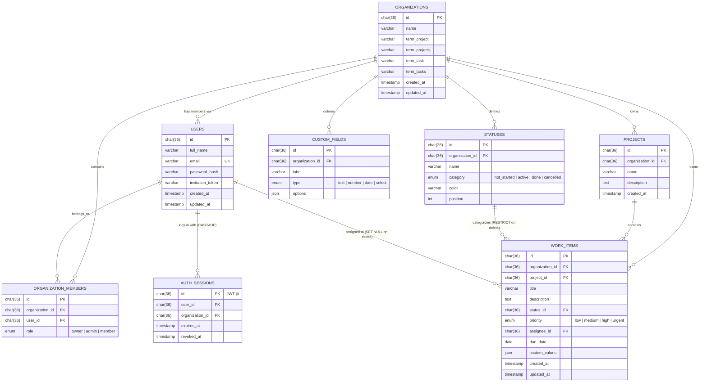

# PM Tool — MySQL Database Documentation

This directory contains the complete database design for the Project Management frontend.

## Files

- [`schema.sql`](file:///d:/pm-frontend%20(1)/database/schema.sql): Complete DDL script with all tables, constraints, foreign keys, and indexes.
- [`seed.sql`](file:///d:/pm-frontend%20(1)/database/seed.sql): Starter data replicating the initial demo state from `mockApi.ts`. Safe to run more than once.
- `migrations/`: Additive changes for databases created from an older `schema.sql` (see below).

The Express backend in `../backend` can run all of these for you: `npm run db:setup` (fresh database), `npm run db:migrate` (existing database), `npm run db:seed`. See `backend/README.md`.

## How to Run in MySQL

### Option 1: MySQL CLI
```bash
mysql -u root -p < schema.sql
mysql -u root -p < seed.sql
# existing database instead of a fresh one:
mysql -u root -p pm_database < migrations/001_auth_sessions.sql
```

### Option 2: MySQL Workbench / phpMyAdmin / DBeaver
1. Open and execute `schema.sql`.
2. Open and execute `seed.sql`.

---

## Changes for the Express backend (2026-10-26)

| Change | Why |
|---|---|
| **New table `auth_sessions`** (`schema.sql` section 8, and `migrations/001_auth_sessions.sql`) | One row per login token (the JWT's `jti`). The backend only accepts a token while its row is active, so logout and member removal take effect immediately. Cascades when a user or organization is deleted. |
| **Real bcrypt hashes in `seed.sql`** | The old placeholder hash could not match any password. Each seeded user now has their own password (table below). Re-running the seed also fixes the hash on an existing database (`ON DUPLICATE KEY UPDATE password_hash`). |
| **Fixed ids for seeded memberships and work items** | They used `UUID()`, so running `seed.sql` twice duplicated every task. Now re-running only updates. |
| **Seeded custom fields** "Department" (select) and "Est. Hours" (number), with values on every task | Matches the demo data in `mockApi.ts`. |
| **`invitation_token` now stores a SHA-256 hash** (no column change) | Invited members get a single-use link; only its hash is kept. `password_hash` stays `NULL` until they accept. |
| **`schema_migrations` table** (created by `backend/scripts`, not in `schema.sql`) | Records which files in `migrations/` have been applied. |

| **`organization_members.status`** (`pending` / `active`, `migrations/002_member_approval.sql`) | Self sign-ups join an existing organization as `pending`. They cannot log in or see anything until a manager approves them (Settings → Members). Rejecting deletes the account. |

**Already ran the old scripts?** Apply `migrations/001_auth_sessions.sql` (or `npm run db:migrate` in `backend`), then re-run `seed.sql`. Nothing is dropped.

---

## Seed Accounts & Dual Views

The starter database seeds accounts for testing both perspectives:

| Name | Email | Password | Role | Dedicated View |
|---|---|---|---|---|
| **Alex Morgan** | `alex@acme.com` | `87654321` | `owner` | **Manager View only** (Portfolio metrics, Team capacity, Workflow admin) |
| **Sarah Connor** | `sarah@acme.com` | `12345678` | `member` (Developer) | **Employee View only** (Personal workstation, tasks grouped by project) |
| **David Kim** | `david@acme.com` | `21345678` | `member` (Developer) | **Employee View only** (Personal workstation, tasks grouped by project) |

---

## Entity Relationship Overview



---

## Key Design Decisions

1. **UUID Primary Keys (`CHAR(36)`)**:
   Matches the frontend's string IDs generated by `crypto.randomUUID()` and allows safe client-side or server-side ID generation.

2. **Multi-Tenancy Isolation (`organization_id`)**:
   Every entity (`projects`, `work_items`, `statuses`, `custom_fields`) carries `organization_id` to guarantee tenant isolation and allow high-performance filtering.

3. **Safe Status Deletion (`ON DELETE RESTRICT`)**:
   When deleting a status column, the frontend requires providing a `moveTo` target status. Setting `ON DELETE RESTRICT` ensures no tasks are accidentally dropped or left orphaned.

4. **Member Removal (`ON DELETE SET NULL`)**:
   When a user leaves or is removed from an organization, their tasks remain intact with `assignee_id` set to `NULL`.

5. **Flexible Custom Fields (`JSON`)**:
   Stored directly as key-value pairs (`{ [fieldId]: value }`) in `work_items.custom_values`, matching TypeScript's `Record<string, string>`. No slow multi-table joins required for standard board and list views.
